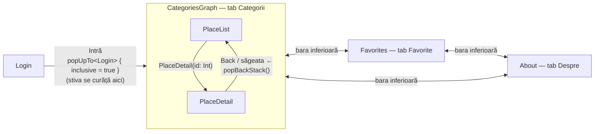

# Ghidul Maramureșului — Obiective turistice

Aplicație Android (Kotlin + Jetpack Compose, Material 3) cu 5 ecrane legate prin
Navigation Compose (Nav2) cu rute type-safe.

## Rulare

- Android Studio: *Open* pe folderul proiectului, apoi *Run 'app'* pe un emulator sau telefon (minSdk 26).
- Din terminal: `./gradlew installDebug`, apoi deschideți aplicația „Ghidul Maramureșului”.

La login se acceptă orice utilizator și parolă nevide.

## Structură

| Fișier | Rol |
|---|---|
| `data/PlacesRepository.kt` | sursa unică de date: 9 obiective (Sport, Muzee, Restaurante) |
| `navigation/Routes.kt` | rutele `@Serializable` (`Login`, `CategoriesGraph`, `PlaceList`, `PlaceDetail(id)`, `Favorites`, `About`) |
| `MainActivity.kt` | `NavHost`, graful imbricat `CategoriesGraph`, bara de navigare inferioară, starea favoritelor |
| `ui/*Screen.kt` | ecranele; nu primesc `NavController`, navigarea iese prin lambda-uri (`onNavigateToDetail`, `onBack`, `onLogin`) |

## Fluxul de navigare

- **Argument:** `PlaceDetail` primește doar `id`, citit cu `toRoute<PlaceDetail>()`; restul vine din `PlacesRepository`.
- **Curățarea stivei:** după login, `popUpTo<Login> { inclusive = true }` scoate Login din stivă, deci Back din listă închide aplicația.
- **Tab-uri:** `popUpTo<PlaceList> { saveState = true }`, `launchSingleTop = true`, `restoreState = true` —
  fiecare tab își păstrează stiva (un detaliu deschis rămâne deschis), iar apăsarea repetată pe tab-ul curent nu adaugă copii.
- **Tab marcat:** se verifică `destination.hierarchy`, astfel că în `PlaceDetail` rămâne marcat Categorii.
- **Filtrul:** ținut cu `rememberSaveable` în intrarea `PlaceList` din NavHost și transmis ecranului (state hoisting);
  se păstrează la detaliu → înapoi, la schimbarea tab-urilor și la rotire.
- **Back consistent:** butonul/gestul Back și săgeata din `TopAppBar` fac același `popBackStack()`.

## Capturi de ecran

Folderul [`screenshots/`](screenshots): login, listă (Toate / Sport / Muzee / Restaurante), detaliu,
favorite (cu elemente și goală), despre, listă după rotire.
